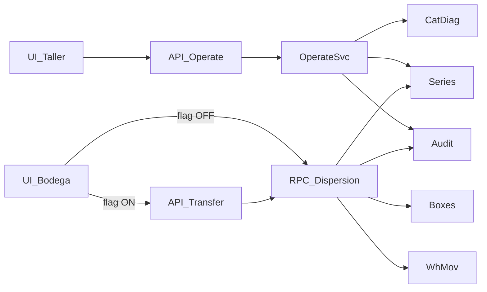

# TC-ERP — Revisión de Arquitectura (Fase A)

**Fecha:** 2026-10-29  
**Commit de referencia:** `91a1bc8af52240d338b7939e35662ed5d28e03d0`  
**Rama de trabajo:** `audit/architecture-integrity-2026-10-29`  
**Alcance:** Auditoría no destructiva + plan técnico. **Sin implementación en esta entrega.**  
**Arquitectura objetivo:** Frontend → API/Application Services → PostgreSQL/Supabase (RPC + RLS) → Auditoría y trazabilidad.

---

## 1. Veredicto de Fase A

TC-ERP ya tiene un **strangler fig** parcial (API `/api/v1/*` + RPC `warehouse_dispersion_tx`), pero la **autoridad final de muchas transiciones de taller sigue en Node (`service_role`)**, no en una RPC atómica. La auditoría 29/10 se confirma con evidencia de código y datos vivos.

| Dimensión | Estado | Riesgo dominante |
| :--- | :---: | :--- |
| Separación UI / API | Parcial | Feature flags permiten bypass de API en bodega |
| Orquestación taller | Parcial | Update + audit en dos round-trips sin TX SQL |
| Integridad de estados | Débil | `series.current_status` es `text` libre; valores legacy coexisten |
| Catálogo diagnóstico→destino | Bueno en TS | Solo enforced en Node/UI; no en PostgreSQL |
| Dispersión bodega | Bueno en SQL | Falta suite E2E aislada; fallback RPC desde browser |
| RLS / privilegios | Alto | `getSupabaseServerClient()` = service role; fallback a anon key |
| Auditoría | Parcial | Insert separado; fallo de red deja estado sin log |

**Gate:** No se implementa Fase B–H hasta aprobación explícita de la **contención crítica** (sección 6).

---

## 2. Arquitectura objetivo vs. estado actual

```text
OBJETIVO                         ACTUAL (flujos críticos)
─────────                        ────────────────────────
Frontend (UX / validación)  →    UI valida destinos + flags
        ↓                              ↓
API / Application Services  →    /operate-batch, /transfer-to-workshop
        ↓                              ↓                    ↘ (flag OFF)
PostgreSQL RPC + RLS + CHECK →   Node service_role update     RPC browser JWT
        ↓                              ↓
Auditoría atómica           →    erp_audit_logs INSERT separado
```

La imagen de arquitectura objetivo es correcta como SSOT de capas. El gap principal es: **taller no cierra el anillo “API → RPC atómica → auditoría”**.

---

## 3. Matriz de dependencias (contratos reales)

### 3.1 Taller — operate batch

| Capa | Artefacto | Contrato | Cliente DB | Notas |
| :--- | :--- | :--- | :--- | :--- |
| UI | `src/app/(erp)/produccion/taller/page.tsx` | `operateWorkshopInBatches(...)` | HTTP | No escribe tablas directas en este flujo |
| API | `src/app/api/v1/workshop/operate-batch/route.ts` | Zod body; `ROLES_TALLER`; tab ACL | JWT usuario (`requireApiUser`) | Autoriza; no persiste |
| App | `workshopOperateService.operateWorkshopSeriesBatch` | seriesIds, result, actionName, diagnostics | **service_role** | Ignora `_userClient` para mutación |
| Policy | `workshopDiagnosticRepairPolicy` + `workshopDiagnosticRepairValidation` | `allowed_outcomes`, `cat_diagnostic_repairs` | Lectura vía service_role | Correcto en TS; no hay TX |
| Persistencia | `series.update` → `erp_audit_logs.insert` | Chunked | service_role | **No atómico** |
| Catálogo | `cat_diagnostics.allowed_outcomes` (mig 287/288) | Array outcomes | — | SSOT de negocio para reacondicionado |

### 3.2 Bodega — transferencia a taller

| Capa | Artefacto | Contrato | Cliente DB | Notas |
| :--- | :--- | :--- | :--- | :--- |
| UI | pantallas bodega → `transferBoxesToArea` | boxIds, área TALLER | Browser | |
| Flag | `isWarehouseTransferApiEnabled()` | `NEXT_PUBLIC_USE_WAREHOUSE_TRANSFER_API` | — | **Opt-in**; default = bypass API |
| API | `transfer-to-workshop/route.ts` | Zod; `ROLES_BODEGA_DESPACHO` | JWT → `rpc(warehouse_dispersion_tx)` | Buen patrón |
| Fallback | `warehouse.ts` L996–1029 | mismo RPC | **Browser JWT** | Salta timeout/contexto unificado API |
| SQL | `warehouse_dispersion_tx` (285) | SECURITY DEFINER, `search_path=public`, FOR UPDATE, idempotency | `app_assert_any_role` | Existe; `workshop_operate_batch_tx` **no existe** |

### 3.3 Recepción / prediagnóstico / costos

| Flujo | Entrada | Riesgo |
| :--- | :--- | :--- |
| `clearAllReceptions` | `receptions.ts` | Delete masivo series+receptions desde **browser client**. **Sin callers** en `src/` hoy → eliminar seguro |
| Prediagnóstico API | `backoffice/prediagnostico/route.ts` | service_role vía store; export masivo N+1 (hallazgo ejecutivo previo) |
| Costos | `getReceptionsWithSeries` | Mitigado en 91a1bc8 a select liviano (sin join series anidado) |

### 3.4 Grafo de módulos (resumen)



---

## 4. Hallazgos con evidencia

### H1 — CRITICAL: Transición de taller no atómica

**Evidencia:** `workshopOperateService.ts` L213–279: `series.update` y luego `erp_audit_logs.insert` por chunk.  
**Impacto:** Estado cambiado sin auditoría si falla el insert o la red.  
**Causa raíz:** Persistencia orquestada en Node con service_role en lugar de RPC `BEGIN…COMMIT`.  
**Corrección planificada:** `public.workshop_operate_batch_tx` (Fase C). Validar outcomes leyendo `cat_diagnostics.allowed_outcomes` — **no hardcodear nombres** como única SSOT (corrección al plan 289 previo).

### H2 — HIGH: Autoridad de negocio solo en TypeScript

**Evidencia:** `assertWorkshopDiagnosticOutcomeAllowed` + UI `OperationDrawer`; PostgreSQL no valida destino vs diagnóstico.  
**Impacto:** Script/service_role/API mal usada puede forzar `ready_to_dispatch` (reacondicionado) con falla física.  
**Corrección:** Misma RPC + tests de rechazo `P0001`.

### H3 — HIGH: Bypass de API en dispersión

**Evidencia:** `clientFlags.ts` + `warehouse.ts` L979 vs L996. Flag opt-in.  
**Impacto:** Dos caminos (API vs browser RPC); timeouts, logging y autorización inconsistentes.  
**Corrección:** Forzar API (default ON o eliminar fallback) tras pruebas.

### H4 — HIGH: Inventario real de estados ≠ lista del CHECK propuesto

**Evidencia (consulta no destructiva, proyecto productivo — solo SELECT):**

| `current_status` | Conteo |
| :--- | ---: |
| in_central_warehouse | 167799 |
| dispatched | 41866 |
| in_validation | 13871 |
| in_control_warehouse | 7310 |
| in_qc | 5320 |
| **RECEPCIONADO_BODEGA_GENERAL** | **5286** |
| irreparable | 4838 |
| in_workshop | 3875 |
| ready_to_dispatch | 271 |
| **INGRESADO** | **46** |
| **in_dispatch_warehouse** | **40** |
| waiting_parts | 15 |

**Impacto:** Un `CHECK` con la lista del informe de integridad **fallaría** al aplicarse.  
**Corrección:** Fase B — catálogo formal + migración de legacy **antes** de cualquier CHECK.

### H5 — HIGH: service_role generalizado + fallback a anon

**Evidencia:** `lib/supabase/server.ts` L16: `SUPABASE_SERVICE_ROLE_KEY || appConfig.supabase.anonKey`.  
**Impacto:** Escalamiento de privilegios en handlers; si falta service key, comportamiento ambiguo.  
**Corrección:** Inventario Fase F; prohibir fallback; mutaciones vía RPC con `auth.uid()`.

### H6 — MEDIUM: `clearAllReceptions` en cliente

**Evidencia:** Definida en `receptions.ts`; grep sin referencias de uso.  
**Corrección:** Eliminar export (contención rápida, bajo riesgo de regresión).

### H7 — MEDIUM: Validación duplicada UI/servidor (aceptable si servidor es SSOT)

UI y servidor repiten outcomes. Correcto como UX **si** PostgreSQL/API es autoridad. Hoy UI+TS son autoridad → duplicación frágil.

### H8 — Confirmado positivo: migraciones 287/288 y dispersión 285

- 287/288: outcomes en catálogo; 5 diagnósticos solo `reacondicionado`.  
- 285: `WHERE TRUE` en temp delete; bypass `app.box_operational_eliminado`; FOR UPDATE; idempotency; assert roles.

---

## 5. Plan técnico (fases alineadas al mandato)

| Fase | Entregable | Dependencia | Aprobación requerida |
| :---: | :--- | :--- | :--- |
| **A** | Este documento + matriz | — | **Entregado — esperar OK** |
| **0 contención** | Quitar `clearAllReceptions`; excluir scripts mutantes de `test:unit`; forzar/documentar flag bodega | A | Sí |
| **B** | `TC-ERP-STATE-TRANSITIONS.md` + inventario completo + mapa código | A | Sí antes de CHECK |
| **C** | Diseño + migración **draft** `workshop_operate_batch_tx` (no apply prod) | B | Sí antes de apply |
| **D** | Diagnóstico unicidad series (SELECT only) + plan índice | B | Sí |
| **E** | Suite integración `warehouse_dispersion_tx` en PG aislado; retirar fallback | 0 | Sí |
| **F** | `TC-ERP-SECURITY-REVIEW.md` inventario service_role | A | Sí |
| **G** | `TC-ERP-UX-REVIEW.md` acciones vs backend | C | Sí |
| **H** | `TC-ERP-REGRESSION-RESULTS.md` | cada fase | Sí |

### Contención crítica propuesta (siguiente paso **solo si se aprueba**)

1. Eliminar `clearAllReceptions` (+ test de ausencia de export).  
2. Asegurar `test:unit` no corre scripts de backfill live.  
3. Documentar / default `USE_WAREHOUSE_TRANSFER_API=true` en entornos (sin migración).  
4. **No** aplicar CHECK de estados ni índice único aún.  
5. **No** aplicar `workshop_operate_batch_tx` a producción sin diseño revisado + pruebas en DB aislada.

### Anti-patrones a evitar en implementación posterior

- Hardcodear nombres `FRIZADO`/`SE FRIZA` en SQL como única fuente (usar `allowed_outcomes`).  
- `@ts-ignore` / `any` para “pasar” typecheck.  
- Deshabilitar RLS.  
- Tests con `COMMIT` contra proyecto remoto de producción.

---

## 6. Archivos inspeccionados (evidencia)

- `src/modules/workshop/server/workshopOperateService.ts`
- `src/modules/workshop/server/workshopDiagnosticRepairValidation.ts`
- `src/modules/workshop/server/workshopTasksService.ts`
- `src/app/api/v1/workshop/operate-batch/route.ts`
- `src/app/api/v1/warehouse/transfer-to-workshop/route.ts`
- `src/app/api/v1/backoffice/prediagnostico/route.ts`
- `src/lib/database/warehouse.ts`
- `src/lib/database/receptions.ts`
- `src/lib/supabase/server.ts`
- `src/shared/feature-flags/clientFlags.ts`
- `src/shared/infrastructure/http/requireApiUser.ts`
- `supabase/migrations/285_fix_dispersion_operational_eliminado_and_temp_delete.sql`
- `supabase/migrations/287_cat_diagnostics_allowed_outcomes.sql`
- `supabase/migrations/288_cat_diagnostics_reacondicionado_only.sql`
- Docs previos: `TC-ERP-AUDIT-EXECUTIVE.md`, `TC-ERP-REMEDIATION-PLAN.md`, `TC-ERP-DATABASE-INTEGRITY.md`

---

## 7. Estado de otros entregables

| Documento | Estado |
| :--- | :--- |
| `TC-ERP-ARCHITECTURE-REVIEW.md` | **Completo (Fase A)** |
| `TC-ERP-STATE-TRANSITIONS.md` | Borrador inventario (siguiente) |
| `TC-ERP-DATABASE-REMEDIATION.md` | Pendiente aprobación post-A |
| `TC-ERP-SECURITY-REVIEW.md` | Pendiente Fase F |
| `TC-ERP-UX-REVIEW.md` | Estándares UX operativos definidos; implementación Fase G pendiente |
| `TC-ERP-REGRESSION-RESULTS.md` | Pendiente Fase H |

---

## 8. Decisión solicitada

**¿Se aprueba la contención crítica (sección 5) en esta rama, sin migraciones productivas?**

Tras el OK se implementará solo esa contención, se entregará diff para revisión independiente, y se detendrá de nuevo antes de Fase B/C.
