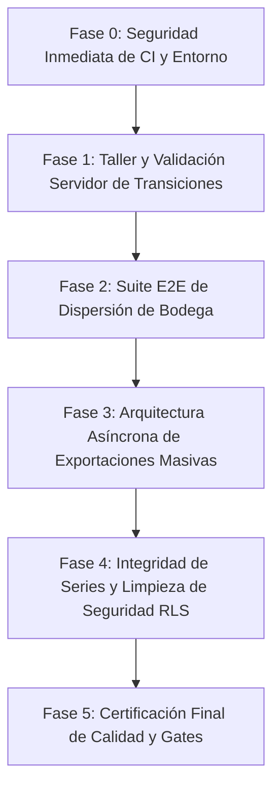

# TC-ERP — Plan Maestro de Remediación y Estabilización

**Fecha:** 2026-10-29  
**Objetivo:** Instrucciones detalladas de implementación para Cursor y criterios de validación para Antigravity.  
**Regla de Oro:** **Cursor implementa según este plan. Antigravity evalúa, audita y aprueba cada fase antes de avanzar a la siguiente.**

---

## 1. Estructura de Fases de Implementación



---

## 2. Especificación Detallada por Fases

### FASE 0: Blindaje Inmediato de CI, Entorno y Pruebas Unitarias
> **Objetivo:** Eliminar el riesgo de mutación accidental en producción y restaurar el pase de `tsc --noEmit`.

1. **Aislamiento de Scripts de Backfill y Exportación:**
   - **Archivo:** `package.json`
   - **Cambio:** Modificar el script `"test:unit"` para excluir todo el directorio `src/scripts/**`:
     ```json
     "test:unit": "vitest run --exclude 'src/scripts/**'"
     ```
   - **Archivo:** `src/scripts/run-prediagnostico-backfill-apply.test.ts`
   - **Cambio:** Añadir una guarda de seguridad obligatoria al inicio de la prueba:
     ```typescript
     if (process.env.ALLOW_LIVE_DB_MUTATION !== 'true') {
       throw new Error('Bloqueado: La prueba ejecuta mutaciones reales. Requiere ALLOW_LIVE_DB_MUTATION=true.');
     }
     ```
2. **Saneamiento de `tsconfig.json`:**
   - **Archivo:** `tsconfig.json`
   - **Cambio:** Añadir `"web"` y `".next"` a la lista `"exclude"`:
     ```json
     "exclude": ["node_modules", "scratch", "web", ".next"]
     ```
3. **Criterio de Aceptación (Gate Fase 0):**
   - `npx tsc --noEmit` debe retornar código de salida 0.
   - `npm run test:unit` debe ejecutarse completamente en verde sin intentar conectarse a Supabase ni mutar datos.

---

### FASE 1: Motor de Transición de Taller en PostgreSQL (Server-Enforced)
> **Objetivo:** Garantizar que las decisiones de negocio sobre Reacondicionado, Reparación L1/L2 y L3 se rechacen a nivel de PostgreSQL y en una transacción atómica, sin depender únicamente de la UI.

1. **Migración SQL (Nueva Migración 289):**
   - **Archivo:** `supabase/migrations/289_workshop_transition_tx.sql`
   - **Lógica:** Crear la función RPC `public.workshop_operate_batch_tx`:
     - Parámetros: `p_series_ids uuid[]`, `p_action_name text`, `p_result text`, `p_notes text`, `p_diagnostics text[]`, `p_operator_id uuid`, `p_operator_name text`.
     - Bloquear con `SELECT id FROM public.series WHERE id = ANY(p_series_ids) FOR UPDATE;`.
     - Validar que todas las series pertenezcan al mismo ciclo y estado compatible.
     - **Regla Reacondicionado:** Si `p_result = 'reacondicionado'`, verificar en la base de datos que todos los diagnósticos de la serie estén en el conjunto permitido (`'SE FRIZA'`, `'FRIZADO'`, `'FIRMWARE OBSOLETO'`, `'NO ACTUALIZA'`, `'ACTUALIZACION DE S.W.'`). De lo contrario:
       ```sql
       RAISE EXCEPTION 'TRANSITION_NOT_ALLOWED: El resultado Reacondicionado solo se permite para diagnósticos de firmware/frizado.' USING ERRCODE = 'P0001';
       ```
     - Si `p_action_name = 'REPARACIÓN COMPLETADA'` y `p_result = 'control_calidad'`, validar que las reparaciones estén registradas en `cat_diagnostic_repairs`.
     - Actualizar `series` y crear los registros en `erp_audit_logs` dentro de la **misma transacción atómica**.
2. **Refactorización en Backend:**
   - **Archivo:** `src/modules/workshop/server/workshopOperateService.ts`
   - **Cambio:** Sustituir los dos pasos de actualización secuencial de Node.js por la invocación directa a la RPC `workshop_operate_batch_tx`.
3. **Criterio de Aceptación (Gate Fase 1):**
   - Pruebas unitarias en `src/modules/workshop/server/workshopOperateService.test.ts` actualizadas para verificar el rechazo de transiciones inválidas.
   - Intento forzado de enviar una serie con falla de hardware a 'reacondicionado' debe retornar excepción `P0001`.

---

### FASE 2: Suite de Pruebas de Integración E2E para `warehouse_dispersion_tx`
> **Objetivo:** Certificar con prueba automatizada y `COMMIT` real que la corrección de la migración 285 funciona de extremo a extremo sin regresiones operativas.

1. **Creación de Test de Integración:**
   - **Archivo:** `src/modules/inventario/server/warehouseDispersionTx.integration.test.ts`
   - **Entorno:** Utilizar el contenedor PostgreSQL efímero / arnés de test ya existente en el repositorio (`@prisma/adapter-pg` / tests de clasificación).
   - **Escenarios a Cubrir:**
     1. **Dispersión Exitosa con COMMIT Real:** Crear caja con 3 series en `in_central_warehouse`. Ejecutar `warehouse_dispersion_tx`. Comprobar:
        - Caja queda en `rack_location = 'ELIMINADO'`.
        - Las 3 series quedan con `current_box_id IS NULL` y `current_status = 'in_workshop'`.
        - Se inserta 1 registro en `warehouse_movements` con `movement_type = 'DISPERSION_CAJA'`.
        - Se insertan 3 registros en `erp_audit_logs` con `action = 'INGRESO A TALLER'`.
     2. **Idempotencia y Reintento:** Ejecutar la misma llamada con el mismo `p_idempotency_key`. Verificar que retorna el resultado previo sin crear registros duplicados ni lanzar error.
     3. **Protección de Caja Vacía:** Ejecutar con una caja sin series; debe lanzar excepción `EMPTY_BOX`.
2. **Criterio de Aceptación (Gate Fase 2):**
   - La suite de integración corre de forma autónoma y finaliza en verde sin depender de conexión a internet ni de la base de datos de producción.

---

### FASE 3: Arquitectura Asíncrona de Exportaciones Masivas (~87,000 filas)
> **Objetivo:** Eliminar el patrón N+1 de 2,800 peticiones REST y prevenir timeouts en solicitudes HTTP web.

1. **Optimización de Consulta de Datos (SQL-First):**
   - **Archivo:** `src/modules/reporting/infrastructure/providers/prediagnostico-report-all-data.ts`
   - **Cambio:** Reemplazar los bucles de `IN_CHUNK = 80` por una consulta agregada con JOINs directos en PostgreSQL (o vista `v_prediagnostico_export_flat`) que proyecte `service_orders`, `series`, `sap_transfer_documents` y catálogos en una sola pasada.
2. **Procesamiento Asíncrono / Streaming:**
   - **Archivo:** `src/modules/reporting/interfaces/ReportingController.ts`
   - **Cambio:** Para volúmenes mayores a 5,000 registros o cuando `filters.allData === true`, el endpoint no debe esperar la finalización síncrona en HTTP:
     - Encolar la generación del reporte (o procesar vía stream progresivo).
     - Almacenar el archivo resultante en Supabase Storage (`reports/prediagnostico/`).
     - Responder inmediatamente con `202 Accepted` y un `jobId` / URL de seguimiento.
3. **Criterio de Aceptación (Gate Fase 3):**
   - Tiempo de generación para el dataset completo reducido de ~15 minutos a menos de 90 segundos.
   - Cero timeouts HTTP en rutas de la API.

---

### FASE 4: Integridad de Series y Blindaje RLS
> **Objetivo:** Prevenir colisiones de números de serie concurrentes y remover funciones peligrosas en cliente.

1. **Índice Único Parcial para Series Activas:**
   - **Archivo:** `supabase/migrations/290_series_active_unique_constraint.sql`
   - **Contenido:**
     ```sql
     CREATE UNIQUE INDEX IF NOT EXISTS uq_series_active_serial
       ON public.series (upper(trim(serial_number)))
       WHERE current_status NOT IN ('dispatched', 'returned', 'irreparable', 'obsolete', 'archivado');
     ```
2. **Eliminación de `clearAllReceptions` en Cliente:**
   - **Archivo:** `src/lib/database/receptions.ts`
   - **Cambio:** Eliminar completamente la función exportada `clearAllReceptions` y cualquier referencia de borrado masivo sin control en capas cliente.
3. **Limpieza de Tipado `any` en Taller:**
   - **Archivo:** `src/modules/workshop/server/workshopTasksService.ts`
   - **Cambio:** Tipar rigurosamente los 40 casos de `any` para cumplir con las directrices de ESLint.
4. **Criterio de Aceptación (Gate Fase 4):**
   - Intento de insertar dos series activas idénticas es rechazado por PostgreSQL con error de violación de unicidad.
   - `npx eslint src/modules/workshop` finaliza con 0 errores.

---

## 3. Protocolo de Evaluación por Antigravity

Una vez que Cursor reporte la finalización de una fase:
1. **Inspección de Diff:** Antigravity revisará con `git diff` los cambios exactos para verificar que no se hayan introducido `@ts-ignore`, `any` injustificados ni alteraciones en reglas operativas ajenas.
2. **Ejecución de Verificación:** Antigravity ejecutará los comandos de verificación de la fase correspondiente.
3. **Emisión de Dictamen:**
   - **APROBADO:** Se autoriza a Cursor a proceder con la siguiente fase.
   - **RECHAZADO:** Se emiten los motivos específicos del rechazo para su corrección inmediata.
