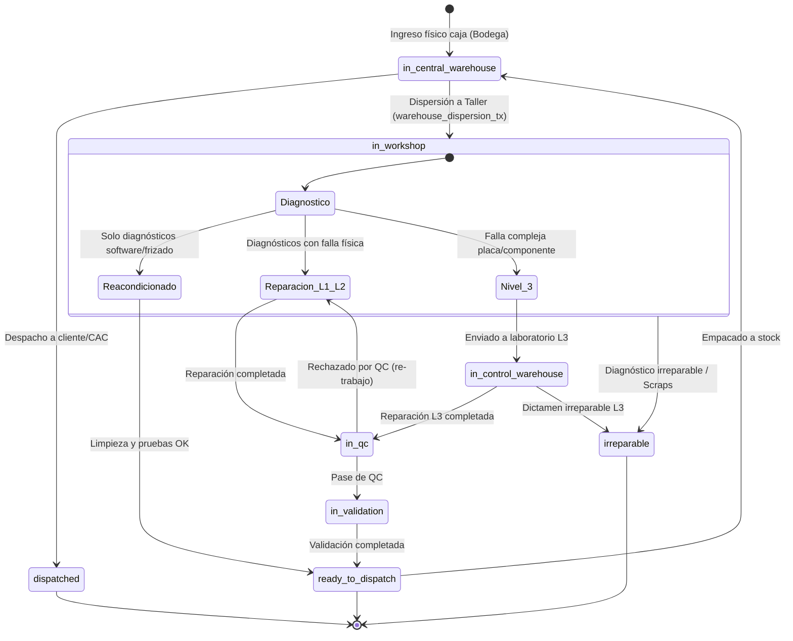

# TC-ERP — Especificación Formal del Motor de Estados (State Machine)

**Fecha:** 2026-10-29  
**Módulos Evaluados:** Recepción, Bodega, Prediagnóstico, Taller, Control de Calidad (QC) y Despacho.  

---

## 1. Estados Canónicos por Entidad

### 1.1 Entidad `series` (`current_status`)



### 1.2 Catálogo de Estados Operativos

| Estado Canónico | Etapa Operativa | Descripción | ¿Es Terminal? |
| :--- | :--- | :--- | :---: |
| `in_central_warehouse` | Bodega Central | Equipo alojado en caja/rack dentro de bodega central. | No |
| `in_workshop` | Taller / Diagnóstico | Equipo asignado a taller en evaluación inicial de diagnóstico. | No |
| `in_qc` | Reparación / Pre-QC | En proceso de reparación activa o esperando inspección de calidad. | No |
| `in_control_warehouse` | Nivel 3 (L3) | En mesa especializada de micro-electrónica / laboratorio L3. | No |
| `in_validation` | Validación QC | Superó QC técnico; en verificación cosmética o administrativa. | No |
| `ready_to_dispatch` | Listo para Despacho | Reacondicionado o reparado listo para empaque y salida. | No |
| `dispatched` | Despachado | Entregado formalmente con remisión y documento de salida. | **Sí** |
| `returned` | Devolución | Devuelto a proveedor o remitente por rechazo de lote. | **Sí** |
| `irreparable` | Scraps / Desecho | Dictaminado irreparable; disponible para canibalización/baja. | **Sí** |
| `obsolete` | Obsoleto | Declarado tecnológicamente obsoleto por el cliente/CAC. | **Sí** |
| `archivado` | Histórico | Cierre de ciclo por auditoría o depuración controlada. | **Sí** |

---

## 2. Matriz de Transiciones Permitidas y Reglas de Validación

| Estado Origen | Estado Destino | Acción de Negocio | Roles Autorizados | Prerrequisitos Obligatorios | Datos Requeridos en Payload | Evidencia de Auditoría (`erp_audit_logs`) |
| :--- | :--- | :--- | :--- | :--- | :--- | :--- |
| `in_central_warehouse` | `in_workshop` | Dispersión de caja a taller | `admin`, `supervisor`, `bodega` | Caja en ubicación válida; caja cerrada con series; bypass activo | `box_id`, `operator_id`, `idempotency_key` | `action: 'INGRESO A TALLER'`, `table_name: 'series'` |
| `in_workshop` | `ready_to_dispatch` | Salida por Reacondicionamiento | `admin`, `supervisor`, `tecnico` | Diagnósticos $\subseteq$ `['SE FRIZA', 'FRIZADO', 'FIRMWARE OBSOLETO', 'NO ACTUALIZA', 'ACTUALIZACION DE S.W.']` | `selectedDiagnostics`, `notes`, `operator_name` | `action: 'DIAGNÓSTICO INICIAL COMPLETADO'`, `result: 'reacondicionado'` |
| `in_workshop` | `in_qc` | Envío a Reparación L1/L2 | `admin`, `supervisor`, `tecnico` | Al menos un diagnóstico con `allowed_outcomes` con `'reparacion'` | `selectedDiagnostics`, `notes` | `action: 'DIAGNÓSTICO INICIAL COMPLETADO'`, `result: 'reparacion'` |
| `in_workshop` | `in_control_warehouse` | Envío a Laboratorio L3 | `admin`, `supervisor`, `tecnico` | Diagnóstico con `allowed_outcomes` con `'l3'` | `selectedDiagnostics`, `notes` | `action: 'DIAGNÓSTICO INICIAL COMPLETADO'`, `result: 'l3'` |
| `in_workshop` | `irreparable` | Dictamen Irreparable en Diag. | `admin`, `supervisor` | Dictamen cosmético o funcional severo | `selectedDiagnostics`, `notes` | `action: 'DIAGNÓSTICO INICIAL COMPLETADO'`, `result: 'scraps'` |
| `in_qc` | `in_validation` | Reparación $\to$ Control de Calidad | `admin`, `supervisor`, `tecnico` | $\ge 1$ reparación del catálogo asociada al diagnóstico persistido | `current_repairs`, `notes` | `action: 'REPARACIÓN COMPLETADA'`, `result: 'control_calidad'` |
| `in_qc` | `ready_to_dispatch` | Reacondicionamiento posterior | `admin`, `supervisor` | Autorización de supervisor técnico | `current_repairs`, `notes` | `action: 'REPARACIÓN COMPLETADA'`, `result: 'reacondicionado'` |
| `in_control_warehouse` | `in_qc` | Retorno de L3 a QC | `admin`, `supervisor`, `tecnico_l3` | Hoja de intervención L3 completada | `current_repairs`, `notes` | `action: 'REPARACIÓN L3 COMPLETADA'`, `result: 'reparacion'` |
| `in_validation` | `ready_to_dispatch` | Aprobación de QC | `admin`, `supervisor`, `calidad` | Checklist de calidad aprobado al 100% | `qc_checklist`, `notes` | `action: 'CONTROL DE CALIDAD COMPLETADO'`, `result: 'listo'` |
| `in_validation` | `in_qc` | Rechazo de QC (Re-trabajo) | `admin`, `supervisor`, `calidad` | Motivo de rechazo registrado | `defect_reason`, `notes` | `action: 'CONTROL DE CALIDAD COMPLETADO'`, `result: 'rechazado_qc'` |
| `ready_to_dispatch` | `dispatched` | Despacho formal | `admin`, `supervisor`, `despacho` | Orden de servicio validada en SAP; remisión generada | `dispatch_id`, `guide_number` | `action: 'DESPACHO SERIE'`, `target: 'CAC'` |

---

## 3. Requerimientos de Implementación en Servidor

1. **Rechazo a Nivel Base de Datos:**  
   Actualmente la validación vive en `src/modules/workshop/server/workshopDiagnosticRepairValidation.ts`. Si una petición salta la capa TypeScript o actualiza directamente vía Supabase client, la base de datos no rechaza la transición.  
   **Requisito:** Implementar función SQL `public.workshop_transition_tx` o trigger `tg_enforce_series_state_transition` que verifique:
   - Que `OLD.current_status` coincida con el estado esperado.
   - Que si `NEW.current_status = 'ready_to_dispatch'` y el origen es `in_workshop`, los diagnósticos cumplan con la restricción de Reacondicionado.
2. **Atomicidad y Bloqueo Concurrente:**  
   `operateWorkshopSeriesBatch` en Node.js debe reemplazarse por una única RPC transaccional que ejecute:
   ```sql
   SELECT id FROM public.series WHERE id = ANY(p_series_ids) FOR UPDATE;
   ```
   Garantizando que dos técnicos no operen la misma OS simultáneamente.
3. **Indivisibilidad del Equipo (OS Siblings):**  
   Todas las series vinculadas a la misma `service_order_id` deben avanzar juntas de estado; ninguna serie secundaria puede quedar en `in_workshop` mientras la principal pasa a `in_qc`.
